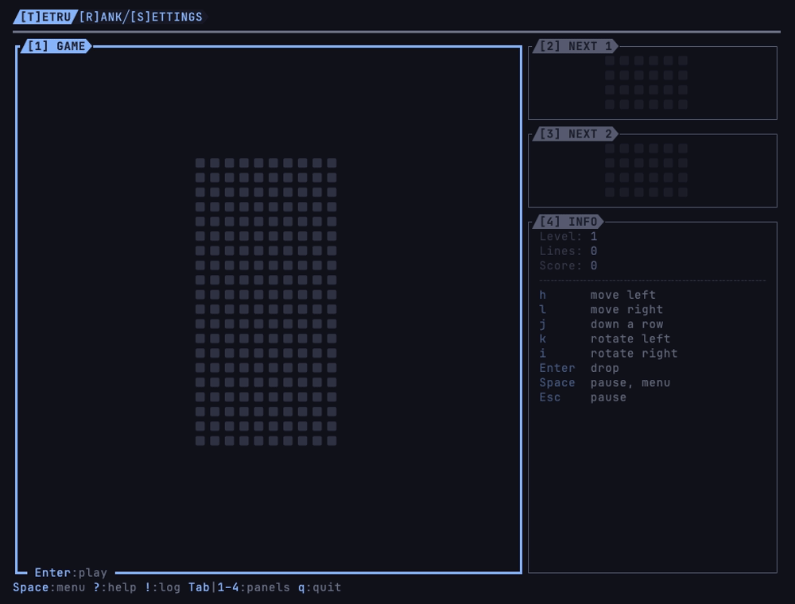

# tetru

[](https://github.com/vulcanshen/tetru/releases)
[](LICENSE)

**Language**: [English](README.md) · 繁體中文

**在終端機裡玩的落塊消行遊戲。**

四格一組的方塊往一個十格寬的井裡掉，趁它落下時左右移動、旋轉，把一整行從左牆排滿到右牆就會消掉。每消十行升一關，
一關比一關掉得快，到第十關為止。每一局的分數都會連同玩家的名字與時間記下來，由高到低排名。



## 特色

- **畫法跟 locku 的落塊螢幕保護一樣**：一樣的方形像素與顏色。左邊是井；右邊是接下來的兩個方塊，各一個 panel，
  再下面是 INFO：關卡、消了幾行、分數，與玩的時候用的鍵。
- **按鍵自己定**：除了 `Space`，玩的時候用的每個鍵都能在 Settings 畫面改。
- **十關速度**：每消十行升一關，從一秒落一行快到一秒落十行；過了第十關就不再加速。
- **每一局都記下來**：時間、名字與分數，在 Rank 畫面由高到低排。先玩，一局結束時才問是誰玩的；不填就是 ANON。玩到一半
  離開也算：按 `q` 離開，或直接關掉終端機，都會記下那一刻的分數。
- **隨時暫停**：`Space` 暫停，順便列出這裡能做什麼；`Esc` 暫停並先離開遊戲，這一局原封不動等你回來。

## 安裝

### 前置需求

- macOS 或 Linux（WSL 也可以）。
- 終端機用 [Nerd Font](https://www.nerdfonts.com)：方塊與框線都是 Nerd Font 的字。
- 終端機支援 truecolor（24-bit 色）：256 色分不出淡化與各層 popup 的顏色。
- 終端機至少 42 欄寬、29 列高，剛好放得下井；60 欄以上，接下來的方塊與 INFO 會並排在旁邊。比這個小時，tetru 只畫出名字、需要的大小
  與怎麼離開，遊戲先停著；終端機拉大就回到原本的畫面。

tetru 啟動時會自己量一個 icon、一個 powerline 符號佔幾格。量錯時可以直接指定：

| 變數 | 指定什麼 |
|---|---|
| `TETRU__ICON_WIDTH` | icon 佔幾格，只給 tetru |
| `TETRU__POWERLINE_WIDTH` | powerline 符號佔幾格，只給 tetru |
| `TERMINU__ICON_WIDTH` | icon 佔幾格，terminu 家族每個 app 共用：設一次，每個 app 都讀得到 |
| `TERMINU__POWERLINE_WIDTH` | powerline 符號佔幾格，terminu 家族每個 app 共用 |
| `LC_TERMINU_ICON_WIDTH` | icon 佔幾格，由有 ssh 的家族 app 連線時帶過來 |
| `LC_TERMINU_POWERLINE_WIDTH` | powerline 符號佔幾格，由有 ssh 的家族 app 連線時帶過來 |

icon 與 powerline 符號各自照表上的順序，用第一個有設的；都沒設才自己量。在家族 app 的終端機裡跑 tetru 時，外層的 app
會替它設好 `TERMINU__` 的兩個；從家族 app 經 ssh 連過來時，拿到的是 `LC_TERMINU_` 的兩個。

### Homebrew

```sh
brew install vulcanshen/tap/tetru
```

### 安裝腳本

```sh
curl -fsSL https://raw.githubusercontent.com/vulcanshen/tetru/main/install.sh | sh
```

不用 sudo：裝在 `~/.local/bin`。

### 第一次啟動

一打開就是 Tetru 畫面，focus 在井上，可以直接開始玩。有分數的一局結束之前，tetru 什麼都不寫：第一次記分數時才建立
`~/.tetru/scores.yaml`，第一次改按鍵時才建立 `~/.config/tetru/config.yaml`。

### 移除

```sh
brew uninstall tetru
```

用安裝腳本裝的：

```sh
curl -fsSL https://raw.githubusercontent.com/vulcanshen/tetru/main/uninstall.sh | sh
```

刪掉 `~/.tetru`（你的分數紀錄）之前會先問。

## 快速開始

1. 執行 `tetru`。
2. 按 `Enter`，遊戲開始。
3. `h`、`l` 左右移動，`e`、`i` 旋轉，`j` 往下一格，`Enter` 直接落到底。
4. 按 `Space` 暫停並看看能做什麼；`Esc` 關掉 menu，遊戲接著走。
5. 遊戲結束時打你的名字再按 `Enter`，或直接按 `Enter` 記成 ANON，分數就記下來了。
6. 按 `q` 離開；還有一局在玩時會先問是誰玩的，並記下這一局的分數。

## 使用方式

```
tetru            開始玩
tetru version    印出版本（-v、--version）
tetru help       印出命令列的用法（-h、--help）
```

tetru 有三個畫面，按它的鍵切換，或從 `Space` menu 的 Global operation 換：

| 鍵 | 畫面 |
|---|---|
| `T` | Tetru：遊戲 |
| `R` | Rank：分數排行，最高的在最上面 |
| `S` | Settings：玩的時候用的鍵 |

玩的時候（遊戲在 `Play` 模式裡），一開始的鍵：

| 鍵 | 做什麼 |
|---|---|
| `h`、`←` | 方塊往左移一格 |
| `l`、`→` | 往右移一格 |
| `j`、`↓` | 往下一格：每一格 1 分 |
| `e` | 往左轉（逆時針） |
| `i` | 往右轉（順時針） |
| `Enter` | 直接落到底並固定：每一格 2 分 |
| `Space` | 暫停，並列出能做什麼；關掉就接著玩 |
| `Esc` | 暫停並離開遊戲；按 `Enter` 繼續 |

在 Settings 畫面的一個動作上按 `Enter`，會列出它能用的鍵；選了之後就換成那個鍵，井旁邊的 INFO 也跟著寫。`←`、`→`、`↓`
不管怎麼設都照樣能移動；`Space` 一直是暫停。

一次消 1、2、3、4 行，分別得 100、300、500、800 分，再乘上當時的關卡。方塊碰到底之後過半秒才固定；這段時間裡移動或
旋轉，會再給半秒，但次數有限。

在 GAME panel 上、沒在玩的時候：

| 鍵 | 做什麼 |
|---|---|
| `Enter` | 直接開新的一局；有暫停中的一局時，接著玩那一局 |
| `n` | 開新的一局；還有一局沒結束時先問是誰玩的，並記下那一局的分數 |
| `x` | 結束還在玩的這一局，先問是誰玩的，並記下分數 |

家族每個 app 都一樣的鍵：

| 鍵 | 做什麼 |
|---|---|
| `Space` | 這裡能做什麼：對這一項、對這個 panel、對整個 app |
| `?` | 這裡能按的每一個鍵 |
| `!` | App Log：做過的事，最新的在最下面；在 tetru 裡是記下的每一筆分數 |
| `Tab`、`1`–`9` | 換到下一個 panel；照編號直接跳到那個 panel。玩的時候要先按 `Esc` |
| `j\|k`、`gg\|G` | 在 Rank 與 Settings 上移動、到最上面、到最下面 |
| `Esc` | 一次關掉最上層的一個 popup；不會離開 tetru |
| `q` | 離開；還有一局在玩時會先問是誰玩的 |

## 設定與資料

| 什麼 | 在哪裡 | 換位置 |
|---|---|---|
| 分數紀錄 | `~/.tetru/scores.yaml` | `TETRU__DATA` |
| 玩的時候用的鍵 | `~/.config/tetru/config.yaml`（`$XDG_CONFIG_HOME/tetru`） | `TETRU__CONFIG` |

0 分的一局不記。tetru 沒有用到家族共用的設定 key。

## 限制

- 一局要結束才會記下：堆到頂、結束這一局或開新局、離開 tetru，或關掉它所在的終端機。程式被直接砍掉（`kill -9`、
  斷電）時，那一局的分數會不見。
- 鍵只能是小寫字母，落到底另外可以用 `Enter`；有幾個字母留給在畫面上移動（`j k u d g h l`），`q` 留給離開，所以 `k`
  暫時不能拿來旋轉：往左轉是 `e`。
- 只有 macOS 與 Linux（WSL 也可以），沒有 Windows 版。

## 相關連結

- [CHANGELOG](CHANGELOG.md)
- [locku](https://github.com/vulcanshen/locku)：tetru 的畫法來自它的落塊螢幕保護

## terminu family

tetru 遵循 terminu design：

- [terminu design](https://github.com/vulcanshen/terminu)：家族的設計規範
- [terminu-go](https://github.com/vulcanshen/terminu-go)：tetru 用來做畫面的 Go 函式庫
- [terminu-harness](https://github.com/vulcanshen/terminu-harness)：照 terminu design 做 app 的 Claude Code plugin

## License

[GPL-3.0](LICENSE)
