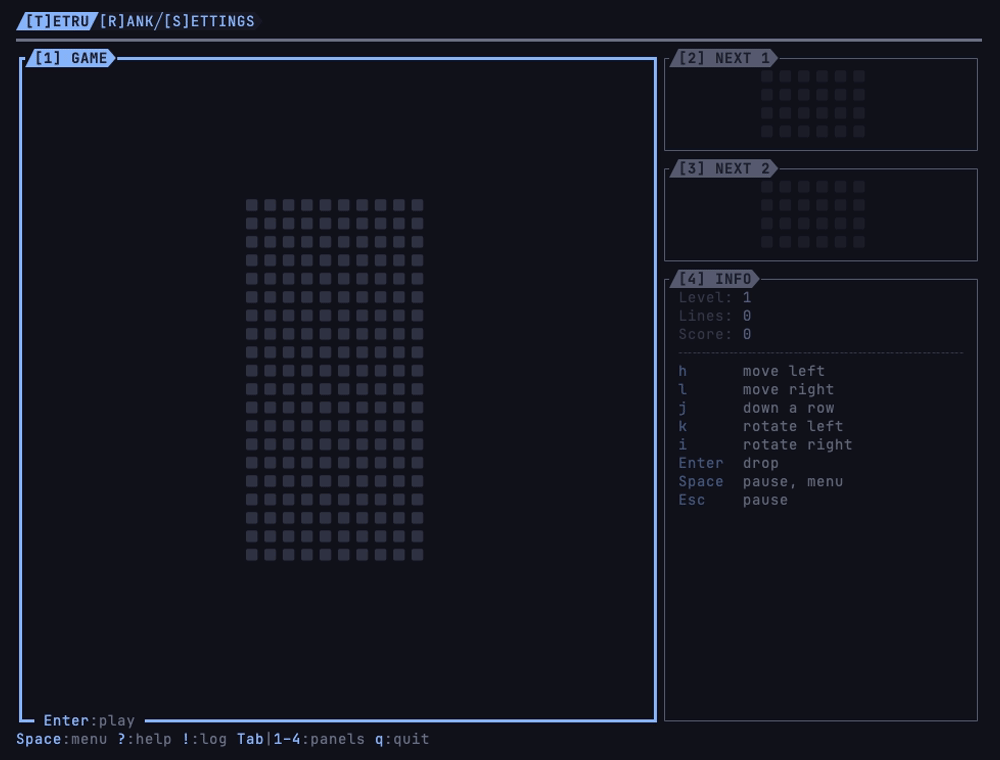

# tetru

[](https://github.com/vulcanshen/tetru/releases)
[](LICENSE)

**Language**: English · [繁體中文](README-zh_TW.md)

**A falling-block game for the terminal.**

Pieces of four blocks fall into a well ten blocks wide; move and turn them as they fall, and fill rows from wall to wall
to clear them. Every ten rows is a level, and every level falls faster, up to the tenth. tetru keeps every game's score
with the player's name and the time, and lists the best beside the well.



## Features

- **Drawn as locku's falling blocks**: the same square pixels, colours and grey frame, the pieces to come in a column
  of boxes at the well's right.
- **Ten levels of speed**: a level every ten rows, from a row a second to ten a second; past the tenth the speed stays.
- **Every game kept**: the time, the name and the score, the best first in the SCORES panel. A game left half way is kept
  too: quitting, or closing the terminal, keeps the score it had then.
- **Pause whenever**: `Space` pauses and shows what you can do; `Esc` pauses and leaves the game where it is.

## Install

### Requirements

- macOS or Linux (WSL too).
- A [Nerd Font](https://www.nerdfonts.com) terminal profile: the blocks and the frames are Nerd Font glyphs.
- A truecolor (24-bit) terminal: the faded colours and the layer colours cannot be told apart in 256 colours.
- A terminal at least 42 columns wide and 26 rows high, the well alone; the scores show beside it from 60 columns on. In a
  smaller one tetru shows only its name, the size it needs and how to quit, and comes back as it was once the terminal
  grows: the game waits meanwhile.

tetru measures how many cells an icon and a powerline symbol take when it starts. When it gets them wrong, set them:

| Variable | What it sets |
|---|---|
| `TETRU__ICON_WIDTH` | The cells an icon takes, for tetru |
| `TETRU__POWERLINE_WIDTH` | The cells a powerline symbol takes, for tetru |
| `TERMINU__ICON_WIDTH` | The cells an icon takes, for every terminu family app: set it once and they all read it |
| `TERMINU__POWERLINE_WIDTH` | The cells a powerline symbol takes, for every terminu family app |
| `LC_TERMINU_ICON_WIDTH` | The cells an icon takes, brought over ssh by a family app with ssh |
| `LC_TERMINU_POWERLINE_WIDTH` | The cells a powerline symbol takes, brought over ssh by a family app with ssh |

For an icon and for a powerline symbol each, tetru takes the first one set in the order of the table, and measures
only when none is. Run inside a family app's terminal, tetru gets the `TERMINU__` ones from the app around it; reached
over ssh from one, the `LC_TERMINU_` ones.

### Homebrew

```sh
brew install vulcanshen/tap/tetru
```

### Script

```sh
curl -fsSL https://raw.githubusercontent.com/vulcanshen/tetru/main/install.sh | sh
```

No sudo: it installs to `~/.local/bin`.

### The first start

tetru opens with the focus on the well, ready to play, and an empty SCORES panel. It writes nothing until a game with
points ends: then `~/.tetru/scores.yaml`.

### Uninstall

```sh
brew uninstall tetru
```

Installed with the script:

```sh
curl -fsSL https://raw.githubusercontent.com/vulcanshen/tetru/main/uninstall.sh | sh
```

It asks before removing `~/.tetru`, your scores.

## Quick start

1. Run `tetru`.
2. Press `Enter`, type your name and press `Enter`: the game starts.
3. `h` and `l` move the piece, `e` and `r` turn it, `j` takes it down a row and `d` drops it.
4. Press `Space` to pause and see what you can do; `Esc` closes the menu and the game goes on.
5. Press `q` to quit; with a game going tetru asks first, and keeps its score.

## Usage

```
tetru            play
tetru version    print the version (-v, --version)
tetru help       print the command-line usage (-h, --help)
```

Playing (the game in the `Play` mode):

| Key | What it does |
|---|---|
| `h\|l`, `←\|→` | Move the piece left, right |
| `j`, `↓` | Move it down a row: a point a row |
| `d`, `PgDn` | Drop it to the bottom and set it there: two points a row |
| `e` | Turn it left (counterclockwise) |
| `r` | Turn it right (clockwise) |
| `Space` | Pause, and show what you can do; close it to go on |
| `Esc` | Pause, out of the game; `Enter` goes on |

Clearing 1, 2, 3 or 4 rows at once scores 100, 300, 500 or 800 times the level. A piece that lies on the stack is set half
a second later; moving or turning it gives it the half second again, a few times.

On the GAME panel, out of the game:

| Key | What it does |
|---|---|
| `Enter` | Play a new game, asking who plays (the last name offered), or go on with the one paused |
| `n` | A new game; with one going, after asking, its score kept |
| `x` | End the game going, after asking, its score kept |

The keys every family app shares:

| Key | What it does |
|---|---|
| `Space` | What you can do here: on this item, on this panel, and for the whole app |
| `?` | Every key that works here |
| `!` | The App Log: what was done, newest last; here, the scores kept |
| `Tab`, `1`–`9` | The next panel; jump to a panel by its number. While playing, `Esc` first |
| `j\|k`, `gg\|G` | On SCORES: move, to the top, to the bottom |
| `Esc` | Close the popup on top, one at a time; it never leaves tetru |
| `q` | Quit; with a game going, after asking |

## Settings and data

| What | Where | To move it |
|---|---|---|
| The scores | `~/.tetru/scores.yaml` | `TETRU__DATA` |

A game with no points is not kept. tetru keeps no settings, and uses none of the family's shared setting keys.

## Limits

- A game is kept only once it ends: when it reaches the top, is ended or a new one started, when tetru quits, or when its
  terminal is closed. A game in a program killed outright (`kill -9`, a power cut) is lost.
- macOS and Linux only (WSL too); there is no Windows build.

## Links

- [CHANGELOG](CHANGELOG.md)
- [locku](https://github.com/vulcanshen/locku): the screensaver whose falling blocks tetru is drawn as

## The terminu family

tetru follows terminu design:

- [terminu design](https://github.com/vulcanshen/terminu): the family's design rules
- [terminu-go](https://github.com/vulcanshen/terminu-go): the Go library tetru is built with
- [terminu-harness](https://github.com/vulcanshen/terminu-harness): the Claude Code plugin for building apps to terminu
  design

## License

[GPL-3.0](LICENSE)
